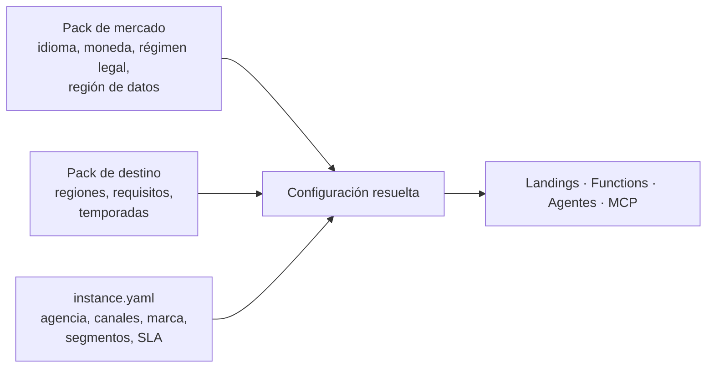
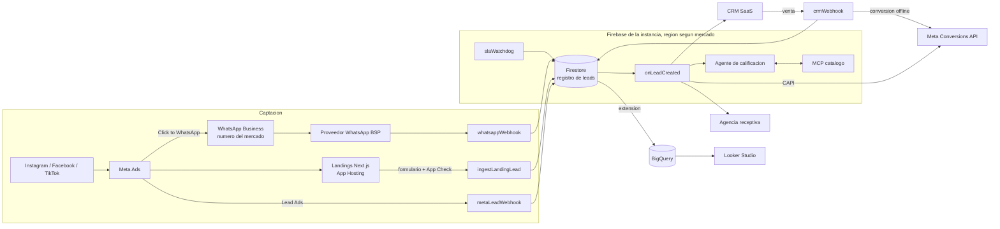

# Travel Leads AI

> Nombre de trabajo del motor. Cada instancia tiene su propia marca.

Motor de **captación y calificación de leads para agencias de viajes receptivas**, potenciado con agentes de IA. Un socio de marketing en un **mercado emisor** (España, Alemania, EE. UU.…) capta viajeros para una agencia que vende y opera tours en un **país de destino** (Ecuador, Perú, Colombia…).

El código es genérico. Cada despliegue real es una **instancia** configurada para una combinación de agencia, destino y mercado:

| Instancia | Destino | Mercado | Estado |
| --- | --- | --- | --- |
| [`ec-es`](instances/ec-es/) | Ecuador | España | draft |

Ver [docs/11-instancias-y-configuracion.md](docs/11-instancias-y-configuracion.md).

## Qué hace

1. **Capta** interesados con contenido en redes y anuncios en Meta, que llevan a landings por producto o directamente a WhatsApp con un número local del mercado.
2. **Registra** cada lead en un registro propio e independiente, con atribución completa y el consentimiento que exija el mercado.
3. **Califica** al interesado (fechas, personas, presupuesto, producto) con un agente de IA en modo asistido, con una persona siempre al final.
4. **Entrega** el lead calificado a la agencia, con un resumen listo para cotizar, y vigila el tiempo de respuesta.
5. **Mide** el embudo completo hasta la venta y devuelve las ventas a Meta como conversiones offline.

### Modelo de negocio y límite legal

La agencia receptiva **cotiza, contrata y cobra** al viajero. El motor **no vende viajes**: solo informa, califica y deriva. Esta frontera está en el código: ningún agente puede confirmar precios, disponibilidad ni reservas. Las obligaciones concretas de cada mercado viven en su pack de mercado. Ver [docs/00-vision.md](docs/00-vision.md).

## Configuración por capas



## Arquitectura (por instancia)



Detalle en [docs/01-arquitectura.md](docs/01-arquitectura.md).

## Stack

| Capa | Tecnología |
| --- | --- |
| Lenguaje | TypeScript en todo el monorepo |
| Front | Next.js (App Router) + React en Firebase App Hosting |
| Backend | Cloud Functions 2ª gen (Node 22) |
| Datos | Firestore → BigQuery, en la región que exija el mercado |
| Configuración | `instance.yaml` + packs de mercado y destino, validados con Zod |
| IA | API de Claude (tool use) y Gemini; MCP para el catálogo |
| Mensajería | WhatsApp Business Platform vía proveedor (BSP) |
| CRM | SaaS (HubSpot o Pipedrive), no se desarrolla |
| Analítica | GTM, GA4, Meta Pixel + Conversions API, Looker Studio |
| Gestor de paquetes | pnpm workspaces |

## Estructura del repositorio

```
.
├── apps/
│   ├── landings/        # Plantilla de landings Next.js
│   └── mcp-catalog/     # Servidor MCP del catálogo de la agencia
├── functions/           # Cloud Functions: webhooks, triggers, agentes
├── packages/
│   ├── shared/          # Tipos y esquemas Zod (incluido InstanceConfig)
│   ├── markets/         # Packs de mercado emisor (es, de, us…)
│   └── destinations/    # Packs de destino (ec, pe, co…)
├── instances/
│   ├── _template/       # Plantilla de instancia
│   └── ec-es/           # Ecuador → España
├── docs/                # Documentación técnica, ADRs y specs
├── scripts/             # Bootstrap de GitHub, validaciones
├── AGENTS.md            # Contexto común para agentes de IA
├── CLAUDE.md            # Entrada para Claude Code
├── GEMINI.md            # Entrada para Gemini CLI
└── firestore.rules      # Deniega todo acceso desde clientes
```

## Puesta en marcha

### Requisitos

- Node 22 (`nvm use`) y pnpm 10 (`corepack enable`).
- Firebase CLI (`npm i -g firebase-tools`) y Java 21 o superior para los emuladores.
- Acceso a los proyectos de Firebase de la instancia con la que vayas a trabajar.

### Primeros pasos

```bash
git clone <url-del-repo> && cd travel-leads-ai
nvm use                                    # usa la versión de .nvmrc (Node 22)
corepack enable
pnpm install
cp .env.example .env.local                 # solo valores de desarrollo
pnpm instance:validate ec-es               # valida la instancia contra el esquema y sus packs
# pnpm instance:build ec-es                 # pendiente (épica Configuración de instancias): genera generated/instance.json
firebase use ec-es-dev
pnpm --filter functions run build          # el emulador de Functions carga functions/lib/
firebase emulators:start                   # Functions + Firestore + UI en :4000
# INSTANCE=ec-es pnpm dev                   # pendiente (épica Landings)
```

### Scripts

| Comando | Qué hace |
| --- | --- |
| `pnpm instance:validate [id]` | Valida una instancia (o todas) contra el esquema y los packs |
| `pnpm instance:build <id>` | Resuelve mercado + destino + instancia en `generated/instance.json` |
| `pnpm instance:seed <id> <env>` | Siembra la configuración operativa en Firestore `config/*` |
| `pnpm deploy:instance <id> <env>` | Despliega una instancia |
| `pnpm dev` | Arranca los paquetes en modo desarrollo (requiere `INSTANCE`) |
| `pnpm lint` / `pnpm typecheck` / `pnpm test` | Calidad estática y tests |
| `pnpm format` / `pnpm format:check` | Formato con Prettier |
| `pnpm evals` | Evaluaciones de los agentes (motor + casos de la instancia) |

> `pnpm instance:validate` ya está disponible (`packages/instance-cli`). Los comandos `instance:build`, `instance:seed`, `deploy:instance` y `pnpm dev` (landings) se implementan en las épicas de Configuración de instancias y Landings (ver roadmap). Mientras tanto, `firebase emulators:start` funciona sin ellos.

## Entornos

Cada instancia tiene dos proyectos de Firebase propios:

| Entorno | Proyecto | Despliegue |
| --- | --- | --- |
| Local | Emuladores | Manual |
| `dev` | `tla-<id>-dev` | Automático al fusionar en `main` |
| `prod` | `tla-<id>-prod` | Tag `<id>@vX.Y.Z` con aprobación manual |

Región de datos y plan Blaze con alerta de presupuesto en todos los proyectos.

## Documentación

| Documento | Contenido |
| --- | --- |
| [00 · Visión](docs/00-vision.md) | Modelo de negocio, alcance, límites, métricas |
| [01 · Arquitectura](docs/01-arquitectura.md) | Componentes, flujos y decisiones |
| [02 · Modelo de datos](docs/02-modelo-de-datos.md) | Colecciones de Firestore y esquemas |
| [03 · Registro de leads](docs/03-registro-de-leads.md) | Ingesta, deduplicación, SLA, reenvío |
| [04 · Landings](docs/04-landings.md) | Plantilla, contenido, tracking, SEO y GEO |
| [05 · Catálogo y MCP](docs/05-catalogo-y-mcp.md) | Catálogo estructurado y servidor MCP |
| [06 · Agentes de IA](docs/06-agentes-ia.md) | Agentes, guardrails, evals, Claude y Gemini |
| [07 · Medición](docs/07-medicion.md) | Eventos, atribución, conversiones offline, KPIs |
| [08 · Seguridad y cumplimiento](docs/08-seguridad-y-cumplimiento.md) | Marco general y pack de mercado UE/España |
| [09 · Flujo de trabajo](docs/09-flujo-de-trabajo.md) | Git, specs, trabajo con IA, onboarding junior |
| [10 · Roadmap](docs/10-roadmap.md) | Fases, hitos y dependencias |
| [11 · Instancias y configuración](docs/11-instancias-y-configuracion.md) | Motor genérico, packs, `instance.yaml`, despliegue |
| [ADRs](docs/adr/) | Registro de decisiones de arquitectura |
| [Specs](docs/specs/) | Especificaciones previas a cada desarrollo |

## Equipo (por instancia)

| Rol | Responsabilidad |
| --- | --- |
| Tech lead del motor | Arquitectura, backend, integraciones, packs, revisión |
| Socio de marketing (mercado) | Contenido, campañas, primer contacto, operación de la instancia |
| Junior | Componentes de landings, contenido, QA de punta a punta, documentación |
| Agencia receptiva (destino) | Catálogo, material audiovisual, cotización, venta y operación |

## Licencia

Privado. Todos los derechos reservados.
