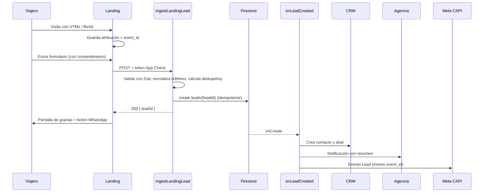

# 01 · Arquitectura

## Principios

1. **Ligero y serverless.** Firebase + TypeScript en todo. Sin servidores que mantener.
2. **Comprar antes que construir.** CRM y WhatsApp vía SaaS. Solo construimos lo que nos diferencia o nos da control: registro de leads, landings, catálogo/MCP y lógica de agentes.
3. **Registro de leads independiente.** Es la fuente de verdad para atribución y comisiones, aunque el CRM o la relación con la agencia cambien.
4. **Datos en la región del mercado.** Cada instancia despliega en la región que exige su pack de mercado (Europa para mercados de la UE).
5. **Humano al final.** La IA asiste; las decisiones comerciales las toma una persona de la agencia.
6. **Motor sin países.** El código no conoce destinos, mercados ni agencias; todo llega por configuración (doc 11).

## Componentes

| Componente | Tecnología | Responsabilidad |
| --- | --- | --- |
| Landings | Next.js en App Hosting | Captación, tracking, SEO/GEO |
| Ingesta | Cloud Functions HTTPS | Webhooks de Meta, WhatsApp, formularios |
| Registro de leads | Firestore | Fuente de verdad de leads, eventos y consentimientos |
| Orquestación | Triggers Firestore + Cloud Tasks | Enriquecer, reenviar, notificar, CAPI |
| SLA | Cloud Scheduler | Alertas de leads sin respuesta |
| Agentes | Functions + API de Claude / Gemini | Calificación y propuestas |
| Catálogo | Firestore + servidor MCP en Cloud Run | Tours, salidas, requisitos, precios orientativos |
| CRM | HubSpot o Pipedrive | Pipeline comercial de la agencia |
| WhatsApp | Cloud API de Meta detrás de un adaptador de BSP ([ADR 0007](adr/0007-whatsapp-cloud-api-adaptador.md)) | API de mensajes y plantillas; bandeja del modo asistido por decidir (#58) |
| Analítica | BigQuery + Looker Studio | Embudo, atribución, comisiones |

## Flujo 1 · Lead desde landing

## Flujo 2 · Lead desde WhatsApp (Click to WhatsApp)

1. El anuncio abre WhatsApp con un mensaje predefinido que incluye un código de campaña.
2. El BSP envía el webhook a `whatsappWebhook`, que responde `200` de inmediato y encola el procesamiento.
3. Se crea o actualiza el lead (`source: whatsapp`), se extrae `ctwa_clid` del referral para la atribución.
4. El agente de calificación propone respuestas (modo asistido). Una persona las aprueba en la bandeja del BSP.
5. Al completar la calificación → `status: qualified` → se reenvía a CRM y agencia.

## Flujo 3 · Venta y conversión offline

1. El vendedor de la agencia mueve el deal a **Ganado** en el CRM.
2. El webhook del CRM llega a `crmWebhook` → actualiza `leads/{id}.status = won` y crea `sales/{id}`.
3. Se envía a Meta un evento `Purchase` con valor y moneda, usando los identificadores originales del lead (email/teléfono hasheados, `fbc`, `ctwa_clid`).
4. La venta queda disponible en BigQuery para el informe de comisiones.

## Decisiones clave

| ADR | Decisión |
| --- | --- |
| [0001](adr/0001-firebase-typescript.md) | Firebase + TypeScript como stack único |
| [0002](adr/0002-crm-saas.md) | CRM SaaS en vez de CRM propio |
| [0003](adr/0003-registro-leads-propio.md) | Registro de leads propio como fuente de verdad |
| [0004](adr/0004-catalogo-mcp.md) | Catálogo estructurado expuesto por MCP |
| [0005](adr/0005-agentes-modo-asistido.md) | Agentes en modo asistido al inicio |
| [0006](adr/0006-motor-generico-instancias.md) | Motor genérico con instancias configurables |

## Proyectos y regiones (por instancia)

Cada instancia despliega esta arquitectura completa en **sus propios proyectos** (doc 11).

| Recurso | Valor |
| --- | --- |
| Proyectos | `tla-<id>-dev`, `tla-<id>-prod`, nuevos y separados de cualquier otro proyecto |
| Firestore | `infra.region` de la instancia, modo nativo. **La región no se puede cambiar después.** |
| Functions / Cloud Run / Scheduler | `infra.region` (o la más cercana permitida por el pack de mercado si el servicio no existe allí) |
| BigQuery dataset | `infra.bigqueryLocation` (`EU` para mercados europeos) |
| Presupuesto | Alertas de facturación al 50 %, 90 % y 100 % |

Ejemplo `ec-es`: `europe-southwest1` (Madrid) y BigQuery `EU`.

## Configuración en el código

- Build: el código importa `generated/instance.json` (resuelto por `pnpm instance:build`). Nunca constantes de país o agencia.
- Runtime: valores operativos en Firestore `config/*`, sembrados desde `instance.yaml`.
- Región de las Functions: se lee de la configuración resuelta en `setGlobalOptions({ region })`.
