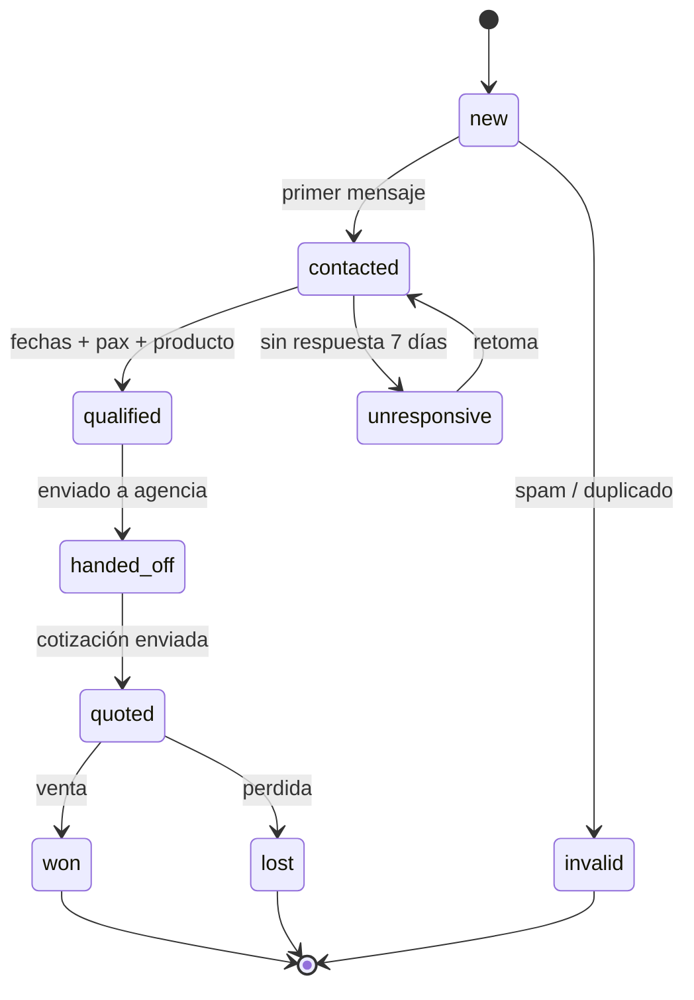

# 02 · Modelo de datos

Fuente de verdad: los esquemas Zod de `packages/shared`. Este documento los describe; si discrepan, manda el código y se corrige este archivo en el mismo PR.

## Colecciones

```
leads/{leadId}
  events/{eventId}          # historial inmutable del lead
  messages/{messageId}      # resumen de mensajes relevantes (no la conversación completa)
sales/{saleId}
consents/{consentId}
catalog_tours/{tourId}
  departures/{departureId}
agent_runs/{runId}          # trazas de ejecución de agentes (sin PII en claro)
config/{docId}              # sla, agents, flags (pnpm instance:seed)
inbox/{deliveryId}          # payloads crudos de webhooks, TTL 7 días (doc 03)
dedupe/{dedupeKey}          # índice para deduplicar personas en transacción (doc 03)
```

## `leads/{leadId}`

`leadId` = ULID generado en servidor. Es el identificador que se comparte con la agencia y el CRM.

| Campo | Tipo | Notas |
| --- | --- | --- |
| `leadId` | string | ULID |
| `dedupeKey` | string | `sha256(telefonoE164)` o `sha256(email)` si no hay teléfono |
| `source` | enum | `landing` · `meta_lead_ad` · `whatsapp` · `manual` |
| `status` | enum | Ver máquina de estados |
| `contact.name` | string | |
| `contact.phoneE164` | string? | Normalizado con libphonenumber. Debe haber `phoneE164` o `email` |
| `contact.email` | string? | En minúsculas |
| `contact.country` | string | ISO 3166-1 alfa-2. En la landing, el del teléfono; si no se deduce, `market.country` |
| `contact.language` | string | Por defecto, el `locale` del mercado |
| `segment` | enum? | `adventure` · `couple` · `senior` · `diaspora` · `other` |
| `interest.tourIds` | string[] | Referencias a `catalog_tours` |
| `interest.travelMonth` | string? | `YYYY-MM` |
| `interest.flexibleDates` | boolean? | |
| `interest.pax` | { adults, children }? | |
| `interest.budgetRange` | string? | Uno de `pricing.budgetRanges` de la instancia, por persona en la moneda del mercado |
| `interest.notes` | string? | Texto libre resumido, sin datos sensibles |
| `attribution` | objeto | Ver abajo |
| `consentId` | string | Referencia a `consents` |
| `assignedTo` | string? | Vendedor de la agencia |
| `crm.contactId` / `crm.dealId` | string? | IDs externos |
| `sla.firstResponseAt` | timestamp? | Primer mensaje humano o aprobado |
| `sla.breachedAt` | timestamp? | |
| `qualification.score` | number? | 0–100, generado por el agente |
| `qualification.summary` | string? | Resumen para el vendedor |
| `createdAt` / `updatedAt` | timestamp | Servidor |
| `retentionUntil` | timestamp | Para borrado automático (ver doc 08). `createdAt` + `compliance.dataRetentionMonths` de la instancia (fijado por el pack de mercado) |

### `attribution`

Todos los campos son opcionales. La landing envía un subconjunto (`AttributionInput`: UTMs, `fbclid`, `fbc`, `fbp`, `gclid`, `eventId`).

| Campo | Notas |
| --- | --- |
| `utmSource`, `utmMedium`, `utmCampaign`, `utmContent`, `utmTerm` | |
| `fbclid`, `fbc`, `fbp` | Para Meta CAPI |
| `ctwaClid` | Click to WhatsApp |
| `gclid` | Si se usa Google Ads |
| `landingSlug` | |
| `metaAdId`, `metaAdsetId`, `metaCampaignId` | Cuando lleguen por Lead Ads o referral |
| `eventId` | Compartido entre Pixel y CAPI para deduplicar |
| `firstTouchAt` | En la landing, la fecha de alta del lead |

### Máquina de estados



Cada transición crea un documento en `leads/{id}/events` con `{type, from, to, actor, at}`. Los eventos **no se modifican nunca**. `from` y `to` son opcionales porque hay eventos que no son transiciones (p. ej. `created`, `reengaged`).

`type` es una lista cerrada (`LeadEventType`); un tipo nuevo se añade al esquema y a esta tabla en el mismo PR:

| `type` | Cuándo | Campos propios |
| --- | --- | --- |
| `created` | Alta del lead | — |
| `reengaged` | La misma persona vuelve con el lead abierto y creado hace menos de 90 días (doc 03) | `attribution`: atribución del nuevo envío (mismo esquema que la del lead). La del lead no se toca |
| `status_changed` | Transición de la máquina de estados | `from`, `to` |

## `sales/{saleId}`

| Campo | Notas |
| --- | --- |
| `leadId` | |
| `tourIds` | |
| `amount`, `currency` | Importe total vendido (ISO 4217; la agencia puede vender en su moneda local) |
| `pax` | |
| `travelDate` | |
| `closedAt` | |
| `commission.rate`, `commission.amount` | Según contrato vigente. `rate` es una fracción 0–1 |
| `commission.status` | `pending` · `invoiced` · `paid` |
| `crmDealId` | Opcional |
| `metaOfflineSentAt` | Opcional. Cuándo se envió la conversión |

## `consents/{consentId}`

Registro probatorio del consentimiento RGPD.

| Campo | Notas |
| --- | --- |
| `leadId` | |
| `purposes` | Lista sin repetidos: `contact` (obligatorio), `marketing` (opcional) |
| `textVersion` | Versión del texto legal mostrado |
| `channel` | `landing` · `meta_form` · `whatsapp` |
| `grantedAt` | |
| `ipHash`, `userAgent` | Evidencia mínima. Opcionales (no hay IP en `meta_form` ni `whatsapp`). `ipHash` = SHA-256 (hex) de la IP seguida del *salt* `IP_HASH_SALT` (Secret Manager); la IP en claro no se guarda ni se registra. `userAgent` se recorta a 500 caracteres |
| `withdrawnAt` | Opcional. Si se revoca |

## `dedupe/{dedupeKey}`

Índice para deduplicar personas dentro de la transacción de ingesta (doc 03). El ID es el `dedupeKey` del lead.

| Campo | Notas |
| --- | --- |
| `leadId` | Último lead creado para esa persona |
| `createdAt` | Fecha de alta de ese lead |

Si el lead apuntado sigue abierto y se creó hace menos de 90 días, un nuevo envío añade un evento `reengaged`; si no, se crea un lead nuevo y este documento pasa a apuntar a él.

## `catalog_tours/{tourId}`

Ver [05-catalogo-y-mcp.md](05-catalogo-y-mcp.md).

## `agent_runs/{runId}`

| Campo | Notas |
| --- | --- |
| `agent` | `qualification` · `proposal` |
| `leadId` | |
| `model` | Ej. `claude-sonnet-x` |
| `promptVersion` | Hash o versión semántica del prompt |
| `toolCalls` | Nombre y duración, sin argumentos con PII |
| `outcome` | `draft_approved` · `draft_edited` · `draft_rejected` · `error` |
| `latencyMs`, `inputTokens`, `outputTokens` | Coste y rendimiento |
| `createdAt` | |

`outcome` es la señal clave para mejorar los prompts: un borrador editado o rechazado es un caso para las evals.

## `config/{docId}`

Valores operativos que se pueden ajustar sin redesplegar. `pnpm instance:seed <id> <env>` los escribe desde la configuración resuelta (`buildConfigDocs` en `packages/shared/src/instance/config-docs.ts`) con `set(..., { merge: true })`: volver a sembrar es idempotente y no borra campos añadidos a mano. Esquemas Zod: `ConfigSla`, `ConfigAgents`, `ConfigFlags`.

| Documento | Campos | Origen |
| --- | --- | --- |
| `config/sla` | `warnAfterMinutes`, `breachAfterMinutes` (enteros > 0), `businessHours` `{ start, end, days }` y `timezone` (IANA) | `sla` de la instancia; horario y zona horaria del mercado resuelto (instancia o pack de mercado) |
| `config/agents` | `qualification { enabled, mode }`, `proposal { enabled }`, `persona { name }` | `agents` de la instancia |
| `config/flags` | `mcpCatalog` | `features` de la instancia |

`businessHours` se interpreta en `timezone`. Los modelos de IA concretos (doc 06) se añadirán a `config/agents` cuando existan en el esquema.

## Exportación a BigQuery

Extensión oficial *Stream Firestore to BigQuery* para `leads`, `sales` y `leads/*/events`. Las vistas de `docs/07-medicion.md` se construyen sobre estas tablas.
