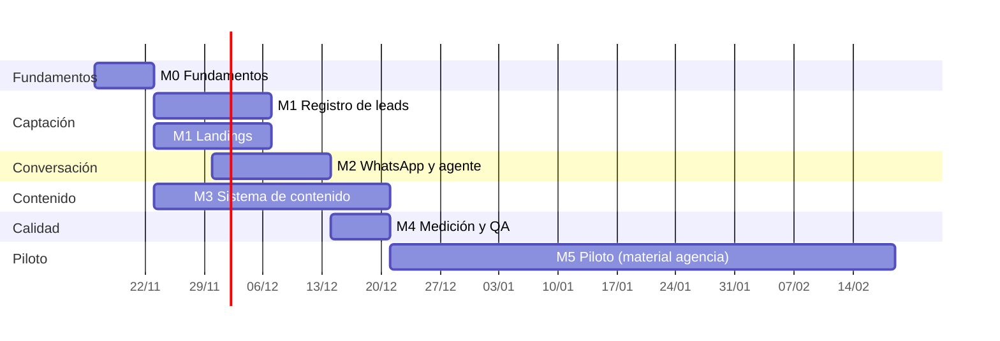

# 10 · Roadmap

Seis semanas para tener el motor listo y probado con su **primera instancia, `ec-es`**; el piloto arranca cuando llega el material de la agencia. Cada tarea indica si es del **motor** (sirve a todas las instancias) o de la **instancia** `ec-es`. Fechas tentativas desde el lunes 16/11/2026; la semana 6 coincide con Navidad, así que el arranque real del piloto probablemente sea en enero, a tiempo para la temporada de venta del verano europeo. Las issues de cada fase se generan desde [`scripts/roadmap-issues.txt`](../scripts/roadmap-issues.txt) con `scripts/bootstrap-github.sh`.

## M0 · Fundamentos (semana 1)

**Motor**

- Monorepo pnpm, CI en GitHub Actions.
- Scaffolding de `packages/shared` con los primeros esquemas Zod, incluido `InstanceConfig`.
- Sistema de instancias: `instance:validate`, `instance:build`, `instance:seed`, `deploy:instance` (doc 11).
- Pack de mercado `es` y pack de destino `ec`.
- `scripts/check-hardcoding.sh` en CI.
- Despliegue por instancia: `main` → `dev` de cada instancia activa; tags `<id>@vX.Y.Z` → `prod`.

**Instancia `ec-es`**

- Proyectos Firebase `tla-ec-es-dev` y `tla-ec-es-prod` en región europea, Blaze, alertas de presupuesto.
- Completar los `TODO` de `instances/ec-es/instance.yaml`.
- Línea española + WhatsApp Business; dominio y correo.
- Meta Business Manager, cuenta publicitaria, Pixel, GTM, GA4.
- Documento de propiedad de activos validado con la agencia.
- Encargo legal: privacidad, cookies, aviso legal, contrato de datos con SCCs.

## M1 · Captación (semanas 2–3)

- Registro de leads: `ingestLandingLead`, `metaLeadWebhook`, inbox idempotente, deduplicación, máquina de estados.
- `onLeadCreated` con Cloud Tasks: CRM, aviso a la agencia, CAPI.
- `slaWatchdog` y `config/sla`.
- Plantilla de landings: modelo de contenido, componentes, formulario con App Check, consentimiento, tracking, JSON-LD.
- CRM configurado con etapas e integración.

## M2 · Conversación (semanas 3–4)

- BSP conectado; `whatsappWebhook`; plantillas aprobadas.
- Guion de calificación humano (documento).
- Agente de calificación en modo asistido + guardrails + evals iniciales.
- Catálogo: esquema y script de ingesta *(bloqueado por los programas de la agencia)*.

## M3 · Contenido (semanas 2–5, en paralelo)

- Perfiles de los cuatro públicos y ejes de contenido.
- Guía de marca *(bloqueado por el logo)*.
- Guía de grabación para los guías de la agencia.
- Flujo de producción con IA y calendario editorial.
- Perfiles en Instagram, Facebook y TikTok; primeras publicaciones orgánicas.

## M4 · Medición y QA (semana 5)

- Extensión Firestore → BigQuery; vistas `v_funnel_daily`, `v_sla`, `v_commissions`.
- Panel en Looker Studio.
- Webhook del CRM y conversión offline `Purchase`.
- Prueba de punta a punta con lead ficticio.

## M5 · Piloto (semana 6 en adelante)

- 2 landings, 2 productos, presupuesto acotado.
- Revisión semanal (doc 07).
- Servidor MCP del catálogo y agente de propuestas.
- Decisión a las 12 semanas: escalar, ajustar o parar.

## Más adelante

- Segunda instancia (otro mercado para la misma agencia, p. ej. `ec-de` o `ec-us`, u otra agencia en `ec-es-<sufijo>`) para validar que el motor no tiene nada fijo de la primera.
- Agente de calificación en modo autónomo (si las evals y los datos lo respaldan).
- Contenido SEO/GEO de larga duración y YouTube.
- Ofrecer el motor a otros receptivos: separar `instances/` en repositorios privados por cliente (ADR 0006).
