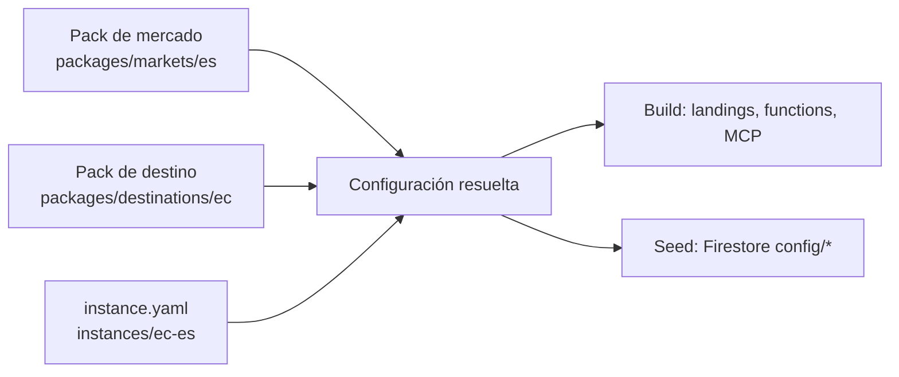

# 11 · Instancias y configuración

Este repositorio es un **motor genérico**. Cada despliegue real es una **instancia**: una combinación concreta de agencia receptiva, país de destino y mercado emisor, definida por configuración y sin tocar el código del motor.

| Ejemplo de instancia | Agencia (destino) | Mercado emisor |
| --- | --- | --- |
| `ec-es` | Receptivo en Ecuador | España |
| `ec-de` | El mismo receptivo | Alemania |
| `pe-es` | Otro receptivo en Perú | España |
| `ec-us` | Receptivo en Ecuador | Estados Unidos |

## Tres capas de configuración



| Capa | Dónde | Qué define | Quién la cambia |
| --- | --- | --- | --- |
| **Mercado** | `packages/markets/<iso>` | Idioma y variante, moneda mostrada, zona horaria, región de teléfono, régimen legal (RGPD, cookies, transparencia IA, normativa de venta de viajes), región de datos permitida, textos legales base, tono del agente | Motor (PR revisado) |
| **Destino** | `packages/destinations/<iso>` | Taxonomía de regiones, moneda local, zona horaria de la agencia, temporadas, fuentes oficiales de requisitos de entrada y avisos de viaje **por mercado** | Motor (PR revisado) |
| **Instancia** | `instances/<id>/instance.yaml` | Agencia, socio, marca, proyectos de Firebase, canales (CRM, BSP, Meta, GTM), segmentos, rangos de presupuesto, SLA, retención, comisiones, agentes activos | Operación de la instancia |

Orden de resolución: **mercado → destino → instancia**. La instancia puede sobrescribir valores por defecto de los packs, salvo los marcados como **bloqueados** por el pack de mercado (por ejemplo, la región de datos permitida o la obligación de avisar de que el agente es una IA).

## Convención de identificadores

```
<destino>-<mercado>[-<sufijo>]
```

- Códigos ISO 3166-1 alfa-2 en minúsculas: `ec-es`, `pe-de`, `ec-us`.
- Sufijo solo si hay dos instancias con el mismo par (dos agencias en el mismo destino): `ec-es-andes`.
- El identificador se usa en proyectos de Firebase, alias de despliegue, tags de versión y carpetas.

## Aislamiento: una instancia, sus propios proyectos

Cada instancia tiene **sus propios proyectos de Firebase** (`dev` y `prod`). No se comparten bases de datos entre instancias.

- Los datos personales de cada mercado quedan en la región que exige su pack (UE para mercados europeos).
- Facturación, accesos y borrado independientes. Cerrar una instancia es borrar sus proyectos.
- Un fallo o un error de configuración en una instancia no afecta a las demás.

Ver [ADR 0006](adr/0006-motor-generico-instancias.md) para las alternativas descartadas (multi-tenant en un solo despliegue).

## Estructura

```
instances/
├── _template/
│   └── instance.yaml          # Plantilla comentada para nuevas instancias
└── ec-es/
    ├── instance.yaml          # Configuración de la instancia
    ├── README.md              # Contexto de negocio de esta instancia
    ├── content/
    │   └── landings/*.json    # Contenido de landings (idioma del mercado)
    ├── prompts/               # Ajustes del agente propios de la agencia (opcional)
    └── evals/                 # Casos de evaluación propios (opcional)

packages/
├── markets/<iso>/             # Pack de mercado
└── destinations/<iso>/        # Pack de destino
```

## Ejemplo resumido de `instance.yaml`

```yaml
id: ec-es
status: pilot
agency:
  slug: agencia-ec
  timezone: America/Guayaquil
destination: { country: EC }
market: { country: ES }        # locale, moneda y zona horaria vienen del pack
infra:
  firebaseProjects: { dev: tla-ec-es-dev, prod: tla-ec-es-prod }
  region: europe-southwest1    # validado contra las regiones permitidas por el pack ES
channels:
  crm: { provider: hubspot }
  whatsapp: { bsp: respond_io, number: "+34XXXXXXXXX" }
segments: [adventure, couple, senior, diaspora]
sla: { warnAfterMinutes: 10, breachAfterMinutes: 30 }
```

La plantilla completa y comentada está en [`instances/_template/instance.yaml`](../instances/_template/instance.yaml).

## Validación

`packages/shared` define el esquema Zod `InstanceConfig`. El comando `pnpm instance:validate [id]` comprueba:

- Estructura y tipos (ISO de país, ISO 4217 de moneda, BCP 47 de idioma, zonas horarias IANA).
- Que existen los packs de mercado y destino referenciados.
- Reglas cruzadas, por ejemplo:
  - mercado con régimen RGPD → `infra.region` en Europa y BigQuery en `EU`;
  - mercado con transferencia a un destino sin decisión de adecuación → `compliance.internationalTransfer: scc`;
  - agente activo → el pack de mercado aporta texto de aviso de IA en el idioma del mercado.
- Que ningún secreto aparece en el YAML (solo referencias `secret:NOMBRE`).

CI valida **todas** las instancias en cada PR.

## Cómo llega la configuración al código

| Momento | Mecanismo |
| --- | --- |
| Build | `pnpm instance:build <id>` resuelve las tres capas y genera `generated/instance.json` para landings, functions y MCP. El código lee siempre de ahí, nunca de constantes. |
| Runtime | Valores operativos (umbrales de SLA, modelos de IA, flags) se siembran en Firestore `config/*` con `pnpm instance:seed <id> <env>` y se pueden ajustar sin redesplegar. |
| Secretos | Secret Manager del proyecto de la instancia. El YAML solo los nombra. |

## Despliegue

```bash
pnpm instance:validate ec-es
pnpm deploy:instance ec-es dev     # usa el alias de Firebase ec-es-dev
pnpm deploy:instance ec-es prod    # requiere tag y aprobación en CI
```

Versionado por instancia con tags `ec-es@v0.3.0`. Una mejora del motor se despliega a cada instancia cuando su responsable lo decide.

## Regla de oro: nada de valores de instancia en el motor

En `apps/`, `functions/` y `packages/shared` no puede aparecer ningún valor propio de un país, mercado o agencia: nombres de países, monedas, prefijos telefónicos, regiones de GCP, textos legales, números de WhatsApp. Todo sale de la configuración resuelta.

`scripts/check-hardcoding.sh` (CI) busca estos patrones fuera de `packages/markets`, `packages/destinations` e `instances/`.

## Crear una instancia nueva

1. `cp -r instances/_template instances/<id>` y rellenar `instance.yaml`.
2. Si el mercado o el destino no tienen pack, crearlo primero (PR al motor, con revisión legal para mercados nuevos).
3. Crear los proyectos de Firebase en la región que indique el pack de mercado.
4. `pnpm instance:validate <id>` y `pnpm instance:seed <id> dev`.
5. Cargar el catálogo de la agencia (doc 05) y el contenido de las landings.
6. Ejecutar la prueba de punta a punta ([spec 002](specs/002-prueba-punta-a-punta.md)).

## Qué cambia entre mercados (y por qué hay packs)

Un mercado nuevo no es solo traducir. Antes de activar uno, su pack debe resolver al menos:

| Aspecto | Ejemplo España / UE | Ejemplo otros mercados (a investigar con asesoría local) |
| --- | --- | --- |
| Protección de datos | RGPD, cláusulas contractuales tipo si el destino no tiene adecuación | Leyes estatales de privacidad, normas de consentimiento para mensajería comercial |
| Venta de viajes | Vender viajes combinados exige ser agencia con garantías | Algunos estados de EE. UU. exigen registro como *seller of travel* |
| Transparencia IA | AI Act: avisar de que se habla con una IA | Según jurisdicción |
| Región de datos | Europa | La que exija o recomiende la normativa |
| Idioma y tono | es-ES, cercano | en-US, de-DE… con su propio tono |
| Avisos de viaje oficiales | Ministerio de Asuntos Exteriores | El organismo equivalente del país emisor |
