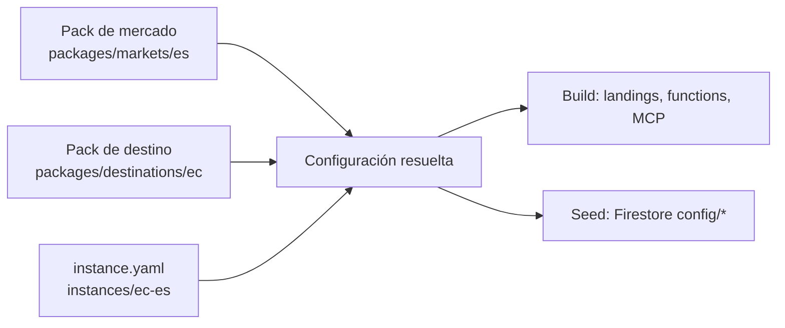

# 11 · Instancias y configuración

Este repositorio es un **motor genérico**. Cada despliegue real es una **instancia**: una combinación concreta de agencia receptiva, país de destino y mercado emisor, definida por configuración y sin tocar el código del motor.

| Ejemplo de instancia | Agencia (destino) | Mercado emisor |
| --- | --- | --- |
| `ec-es` | Receptivo en Ecuador | España |
| `ec-de` | El mismo receptivo | Alemania |
| `pe-es` | Otro receptivo en Perú | España |
| `ec-us` | Receptivo en Ecuador | Estados Unidos |

## Tres capas de configuración



| Capa | Dónde | Qué define | Quién la cambia |
| --- | --- | --- | --- |
| **Mercado** | `packages/markets/<iso>` | Idioma y variante, moneda mostrada, zona horaria, región de teléfono, régimen legal (RGPD, cookies, transparencia IA, normativa de venta de viajes), región de datos permitida, textos legales base, tono del agente | Motor (PR revisado) |
| **Destino** | `packages/destinations/<iso>` | Taxonomía de regiones, moneda local, zona horaria de la agencia, temporadas, fuentes oficiales de requisitos de entrada y avisos de viaje **por mercado** | Motor (PR revisado) |
| **Instancia** | `instances/<id>/instance.yaml` | Agencia, socio, marca, proyectos de Firebase, canales (CRM, BSP, Meta, GTM), segmentos, rangos de presupuesto, SLA, retención, comisiones, agentes activos | Operación de la instancia |

Orden de resolución: **mercado → destino → instancia**. La instancia puede sobrescribir valores por defecto de los packs, salvo los marcados como **bloqueados** por el pack de mercado (por ejemplo, la región de datos permitida o la obligación de avisar de que el agente es una IA).

## Convención de identificadores

```
<destino>-<mercado>[-<sufijo>]
```

- Códigos ISO 3166-1 alfa-2 en minúsculas: `ec-es`, `pe-de`, `ec-us`.
- Sufijo solo si hay dos instancias con el mismo par (dos agencias en el mismo destino): `ec-es-andes`.
- El identificador se usa en proyectos de Firebase, alias de despliegue, tags de versión y carpetas.

## Aislamiento: una instancia, sus propios proyectos

Cada instancia tiene **sus propios proyectos de Firebase** (`dev` y `prod`). No se comparten bases de datos entre instancias.

- Los datos personales de cada mercado quedan en la región que exige su pack (UE para mercados europeos).
- Facturación, accesos y borrado independientes. Cerrar una instancia es borrar sus proyectos.
- Un fallo o un error de configuración en una instancia no afecta a las demás.

Ver [ADR 0006](adr/0006-motor-generico-instancias.md) para las alternativas descartadas (multi-tenant en un solo despliegue).

## Estructura

```
instances/
├── _template/
│   └── instance.yaml          # Plantilla comentada para nuevas instancias
└── ec-es/
    ├── instance.yaml          # Configuración de la instancia
    ├── README.md              # Contexto de negocio de esta instancia
    ├── content/
    │   └── landings/*.json    # Contenido de landings (idioma del mercado)
    ├── prompts/               # Ajustes del agente propios de la agencia (opcional)
    └── evals/                 # Casos de evaluación propios (opcional)

packages/
├── markets/<iso>/             # Pack de mercado
└── destinations/<iso>/        # Pack de destino
```

## Ejemplo resumido de `instance.yaml`

```yaml
id: ec-es
name: "Ecuador desde España"
status: draft                  # draft | pilot | active | paused
agency:
  slug: agencia-ec
  legalName: ""                # obligatorio fuera de draft
  country: EC
  timezone: America/Guayaquil  # opcional; vacío u omitido = la del pack de destino
  notify: { channel: whatsapp_group, target: secret:AGENCY_NOTIFY_TARGET }
partner: { legalName: "", country: ES }
destination: { country: EC }
market: { country: ES }        # locale, moneda y zona horaria vienen del pack
infra:
  firebaseProjects: { dev: tla-ec-es-dev, prod: tla-ec-es-prod }
  region: europe-southwest1    # validado contra las regiones permitidas por el pack ES
  bigqueryLocation: EU
channels:
  crm: { provider: hubspot, tokenSecret: secret:CRM_API_TOKEN }
  whatsapp: { bsp: respond_io, number: "", webhookSecret: secret:WHATSAPP_BSP_WEBHOOK_SECRET }
segments:
  - { id: adventure, label: "Aventura y naturaleza" }
  - { id: couple, label: "Parejas y luna de miel" }
sla: { warnAfterMinutes: 10, breachAfterMinutes: 30 }
commission: { model: fee_plus_commission, rate: 0 }   # fracción 0–1; > 0 fuera de draft
```

La plantilla completa y comentada está en [`instances/_template/instance.yaml`](../instances/_template/instance.yaml).

## Esquemas de configuración

Los tres esquemas Zod viven en `packages/shared/src/instance/` y se exportan desde `@tla/shared`: `InstanceConfig`, `MarketPack` y `DestinationPack` (cada uno con su tipo TypeScript del mismo nombre). Validan **estructura y formato** de cada capa por separado; las reglas que cruzan capas (región frente a mercado, existencia de packs, `scc` según adecuación, claves bloqueadas) se aplican al resolver la configuración.

### Reglas comunes

- **Objetos cerrados.** Una clave desconocida (por ejemplo, una errata) es un error.
- **Formatos sin listas de países.** País: ISO 3166-1 alfa-2 por formato (dos letras mayúsculas, sin lista cerrada, así que `XX`/`YY` de la plantilla son válidos). Moneda: ISO 4217, idioma: BCP 47 y zona horaria: IANA, comprobados con la API `Intl` del entorno de ejecución. Cada error indica el campo (`market.country`) y el estándar incumplido.
- **Secretos.** `agency.notify.target`, `channels.crm.tokenSecret`, `channels.whatsapp.webhookSecret` y `channels.meta.capiTokenSecret` deben ser `secret:NOMBRE` (mayúsculas, dígitos y `_`). Un valor en claro se rechaza.
- **Campos pendientes.** Los campos de texto que la plantilla deja en `""` admiten la cadena vacía en cualquier `status`; si traen valor, se valida su formato. Excepción: fuera de `draft` (es decir, en `pilot`, `active` y `paused`) son obligatorios `agency.legalName`, `partner.legalName`, `channels.whatsapp.number` (E.164) y `commission.rate > 0`, con un error por cada campo que falte.

### `InstanceConfig` (`instances/<id>/instance.yaml`)

| Campo | Tipo y validación | Vacío admitido |
| --- | --- | --- |
| `id` | `<destino>-<mercado>[-<sufijo>]`: `^[a-z]{2}-[a-z]{2}(-[a-z0-9]+)?$` | No |
| `name` | Texto | No |
| `status` | `draft` · `pilot` · `active` · `paused` | No |
| `agency.slug` | Identificador: minúsculas, dígitos, `-` y `_` | No |
| `agency.legalName` | Texto | Solo en `draft` |
| `agency.country` | ISO 3166-1 alfa-2 | No |
| `agency.timezone` | IANA. Opcional; vacío u omitido = la del pack de destino | Sí |
| `agency.website` | URL `https://` | Sí |
| `agency.notify.channel` | `whatsapp_group` · `email` · `slack` | No |
| `agency.notify.target` | `secret:NOMBRE` | No |
| `partner.legalName` | Texto | Solo en `draft` |
| `partner.country` | ISO 3166-1 alfa-2 | No |
| `destination.country` | ISO 3166-1 alfa-2 | No |
| `market.country` | ISO 3166-1 alfa-2 | No |
| `market.locale` | BCP 47. Opcional (por defecto, el del pack) | — |
| `market.currency` | ISO 4217. Opcional | — |
| `market.timezone` | IANA. Opcional | — |
| `market.phoneDefaultRegion` | ISO 3166-1 alfa-2. Opcional | — |
| `market.businessHours` | Opcional. `start` y `end` en `HH:MM` (24 h, `end` > `start`); `days`: lista no vacía y sin repetidos de 1 (lunes) … 7 (domingo) | — |
| `brand.displayName` | Texto | Sí |
| `brand.domain` | Nombre de dominio, sin esquema ni ruta | Sí |
| `brand.logo` | Ruta en Cloud Storage o en `content/` | Sí |
| `brand.primaryColor` | `#RRGGBB` | No |
| `infra.firebaseProjects.dev` / `.prod` | ID de proyecto (6–30 caracteres: minúsculas, dígitos y `-`) | No |
| `infra.region` | Región de Google Cloud (formato `<área>-<zona><n>`) | Sí |
| `infra.bigqueryLocation` | Multirregión en mayúsculas o región de Google Cloud | Sí |
| `channels.crm.provider` | `hubspot` · `pipedrive` | No |
| `channels.crm.tokenSecret` | `secret:NOMBRE` | No |
| `channels.whatsapp.bsp` | `respond_io` · `360dialog` · `other` | No |
| `channels.whatsapp.number` | E.164 (`+` y 7–15 dígitos) | Solo en `draft` |
| `channels.whatsapp.webhookSecret` | `secret:NOMBRE` | No |
| `channels.meta.pixelId` / `.pageId` | Dígitos | Sí |
| `channels.meta.adAccountId` | Dígitos, con prefijo `act_` opcional | Sí |
| `channels.meta.capiTokenSecret` | `secret:NOMBRE` | No |
| `channels.gtmId` | `GTM-…` | Sí |
| `channels.ga4MeasurementId` | `G-…` | Sí |
| `segments[]` | Lista no vacía de objetos `{ id, label }`; `id` es un identificador único en la lista; `label` en el idioma del mercado | `label`: sí |
| `pricing.budgetRanges[]` | Lista de rangos por persona: `<N`, `N-M` o `>N` (puede estar vacía) | — |
| `sla.warnAfterMinutes` / `.breachAfterMinutes` | Enteros positivos; `breachAfterMinutes` > `warnAfterMinutes` | No |
| `compliance.dataRetentionMonths` | Entero positivo | No |
| `compliance.legalTextsVersion` | Texto | Sí |
| `compliance.internationalTransfer` | `scc` · `adequacy` · `none` | No |
| `commission.model` | `fee` · `commission` · `fee_plus_commission` | No |
| `commission.rate` | Fracción entre 0 y 1 (`0.1` = 10 %) | `0` solo en `draft` |
| `agents.qualification.enabled` | Booleano | No |
| `agents.qualification.mode` | `assisted` · `autonomous` (este último requiere ADR) | No |
| `agents.proposal.enabled` | Booleano | No |
| `agents.persona.name` | Texto | Sí |
| `features.mcpCatalog` | Booleano | No |

### `MarketPack` (`packages/markets/<iso>`)

| Campo | Tipo y validación |
| --- | --- |
| `country` | ISO 3166-1 alfa-2 del mercado emisor |
| `locale` | BCP 47: idioma y variante de los textos para viajeros |
| `currency` | ISO 4217: moneda en la que se muestran los precios orientativos |
| `timezone` | IANA: zona horaria del mercado |
| `phoneDefaultRegion` | ISO 3166-1 alfa-2: región para interpretar teléfonos sin prefijo |
| `businessHours` | Horario de atención por defecto (mismo formato que `market.businessHours`) |
| `legalRegime` | Régimen de protección de datos: `gdpr` · `ccpa` · `lgpd` · `other` |
| `dataRegions` | Lista no vacía y sin repetidos de regiones de Google Cloud permitidas para los datos |
| `bigqueryLocation` | Ubicación de BigQuery exigida (multirregión o región) |
| `dataRetentionMonths` | Entero positivo: conservación por defecto de leads sin venta |
| `internationalTransferWithoutAdequacy` | `scc` · `adequacy` · `none`: mecanismo exigido si el destino no tiene decisión de adecuación para este mercado |
| `aiDisclosure` | `{ text, version }`: aviso de que el viajero habla con una IA, en el idioma del mercado |
| `legalTexts` | `{ version, privacyNotice, commercialConsent, marketingConsent?, cookieBanner? }`: textos legales base con una versión común |
| `priceDisclaimer` | Texto: aviso de precios orientativos |
| `agentTone` | Texto: tono del agente para los prompts |
| `locked` | Lista sin repetidos de claves de este pack que la instancia no puede sobrescribir: `locale`, `currency`, `timezone`, `phoneDefaultRegion`, `businessHours`, `legalRegime`, `dataRegions`, `bigqueryLocation`, `dataRetentionMonths`, `internationalTransferWithoutAdequacy`, `aiDisclosure`, `legalTexts`, `priceDisclaimer`, `agentTone` |

Las versiones (`aiDisclosure.version`, `legalTexts.version`) son `draft` o un identificador como `1.0.0` o `2026-01`. Los textos no pueden estar vacíos.

### `DestinationPack` (`packages/destinations/<iso>`)

| Campo | Tipo y validación |
| --- | --- |
| `country` | ISO 3166-1 alfa-2 del destino |
| `currency` | ISO 4217: moneda local |
| `timezone` | IANA: zona horaria por defecto de la agencia |
| `regions[]` | Lista no vacía de `{ id, label }` con `id` único: taxonomía de regiones con la que se clasifican los tours |
| `seasons[]` | Lista de `{ id, label, months, regions? }`: `id` único, `months` de 1 a 12 sin repetidos, `regions` (opcional) con ids de `regions[]`; si se omite, la temporada aplica a todo el destino |
| `markets` | Objeto con al menos un mercado; la clave es el código ISO 3166-1 alfa-2 del mercado emisor (mayúsculas, como `market.country`) |
| `markets.<PAÍS>.entryRequirements[]` | Lista no vacía de fuentes oficiales `{ label, url }` (URL `https://`) de requisitos de entrada |
| `markets.<PAÍS>.travelAdvice[]` | Lista no vacía de fuentes oficiales `{ label, url }` de avisos de viaje del mercado sobre el destino |
| `markets.<PAÍS>.adequacyDecision` | Booleano: si el destino tiene decisión de adecuación de protección de datos para ese mercado (determina si aplica `internationalTransferWithoutAdequacy`) |

## Validación

`packages/shared` define los esquemas Zod `InstanceConfig`, `MarketPack` y `DestinationPack` (ver [Esquemas de configuración](#esquemas-de-configuración)). El comando `pnpm instance:validate [id]` comprueba:

- Estructura y tipos (ISO de país, ISO 4217 de moneda, BCP 47 de idioma, zonas horarias IANA).
- Que existen los packs de mercado y destino referenciados.
- Reglas cruzadas, por ejemplo:
  - mercado con régimen RGPD → `infra.region` en Europa y BigQuery en `EU`;
  - mercado con transferencia a un destino sin decisión de adecuación → `compliance.internationalTransfer: scc`;
  - agente activo → el pack de mercado aporta texto de aviso de IA en el idioma del mercado.
- Que ningún secreto aparece en el YAML (solo referencias `secret:NOMBRE`).

CI valida **todas** las instancias en cada PR.

## Cómo llega la configuración al código

| Momento | Mecanismo |
| --- | --- |
| Build | `pnpm instance:build <id>` resuelve las tres capas y genera `generated/instance.json` para landings, functions y MCP. El código lee siempre de ahí, nunca de constantes. |
| Runtime | Valores operativos (umbrales de SLA, modelos de IA, flags) se siembran en Firestore `config/*` con `pnpm instance:seed <id> <env>` y se pueden ajustar sin redesplegar. |
| Secretos | Secret Manager del proyecto de la instancia. El YAML solo los nombra. |

## Despliegue

```bash
pnpm instance:validate ec-es
pnpm deploy:instance ec-es dev     # usa el alias de Firebase ec-es-dev
pnpm deploy:instance ec-es prod    # requiere tag y aprobación en CI
```

Versionado por instancia con tags `ec-es@v0.3.0`. Una mejora del motor se despliega a cada instancia cuando su responsable lo decide.

## Regla de oro: nada de valores de instancia en el motor

En `apps/`, `functions/` y `packages/shared` no puede aparecer ningún valor propio de un país, mercado o agencia: nombres de países, monedas, prefijos telefónicos, regiones de GCP, textos legales, números de WhatsApp. Todo sale de la configuración resuelta.

`scripts/check-hardcoding.sh` (CI) busca estos patrones fuera de `packages/markets`, `packages/destinations` e `instances/`.

## Crear una instancia nueva

1. `cp -r instances/_template instances/<id>` y rellenar `instance.yaml`.
2. Si el mercado o el destino no tienen pack, crearlo primero (PR al motor, con revisión legal para mercados nuevos).
3. Crear los proyectos de Firebase en la región que indique el pack de mercado.
4. `pnpm instance:validate <id>` y `pnpm instance:seed <id> dev`.
5. Cargar el catálogo de la agencia (doc 05) y el contenido de las landings.
6. Ejecutar la prueba de punta a punta ([spec 002](specs/002-prueba-punta-a-punta.md)).

## Qué cambia entre mercados (y por qué hay packs)

Un mercado nuevo no es solo traducir. Antes de activar uno, su pack debe resolver al menos:

| Aspecto | Ejemplo España / UE | Ejemplo otros mercados (a investigar con asesoría local) |
| --- | --- | --- |
| Protección de datos | RGPD, cláusulas contractuales tipo si el destino no tiene adecuación | Leyes estatales de privacidad, normas de consentimiento para mensajería comercial |
| Venta de viajes | Vender viajes combinados exige ser agencia con garantías | Algunos estados de EE. UU. exigen registro como *seller of travel* |
| Transparencia IA | AI Act: avisar de que se habla con una IA | Según jurisdicción |
| Región de datos | Europa | La que exija o recomiende la normativa |
| Idioma y tono | es-ES, cercano | en-US, de-DE… con su propio tono |
| Avisos de viaje oficiales | Ministerio de Asuntos Exteriores | El organismo equivalente del país emisor |
